<div align="center">


# Homeport

**Deploy Node apps to the computer under your desk.**

[](https://github.com/DarmawanWeb/homeport-management/actions/workflows/ci.yml)
[](https://darmawanweb.github.io/homeport-management/)


[Documentation](https://darmawanweb.github.io/homeport-management/) &nbsp;|&nbsp; [Getting started](https://darmawanweb.github.io/homeport-management/guide/getting-started) &nbsp;|&nbsp; [Architecture](https://darmawanweb.github.io/homeport-management/reference/architecture) &nbsp;|&nbsp; [Design decisions](https://darmawanweb.github.io/homeport-management/decisions/)

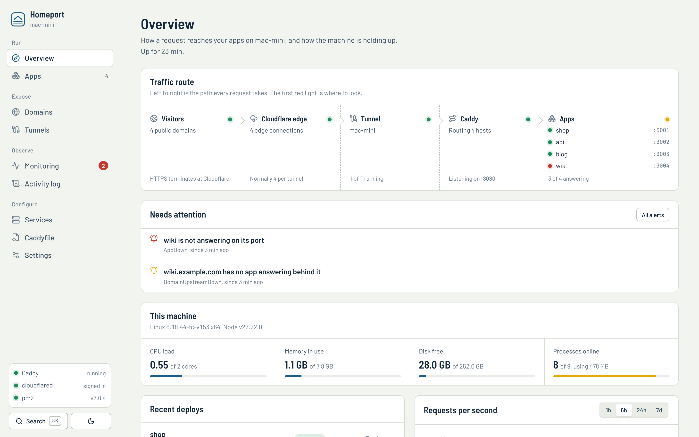

</div>

Homeport turns a Mac mini, a Linux box or a Synology NAS into a small deployment platform. Push to GitHub and the app is built, started and health-checked. If the new version does not come up, the last good commit is rebuilt and you get a message about it. Domains go through Cloudflare Tunnel, so nothing is opened on the router, and the whole thing is run from one dashboard: on your local network by default, or from anywhere behind a password and two-factor sign-in.

It is made for one person or a small team running their own Node services: side projects, internal tools, client sites, a home lab.

## Features

**Deploys**
- Push to deploy through a GitHub webhook (HMAC-verified), a polling timer, or the Deploy button.
- Automatic rollback to the last commit that worked, with a Discord or Telegram notification.
- npm, pnpm, yarn and bun, detected from the lockfile. Turborepo and workspace monorepos, git submodules included.
- Zero-downtime reloads under pm2, a live build log, and any commit on the branch one click from production.

**Domains**
- Root domains and subdomains on any Cloudflare zone. DNS, tunnel ingress and Caddy are updated in one step.
- Generated Caddy config, validated before it replaces the running one.
- A default domain for new apps (`shop` goes live at `shop.example.com`), and an optional password per site.

**Monitoring**
- Prometheus, Grafana and node_exporter, installed, provisioned and served behind the dashboard's sign-in.
- Eleven alert rules, crash detection that ignores planned restarts, and charts in the dashboard itself.
- Analytics read from the proxy log, with no script, no cookies and no stored IP addresses.
- Uptime checks that go out through Cloudflare and back, incidents, and a public status page.

**Access**
- Local network out of the box. Tailscale or a public hostname when you need it.
- People with admin and viewer roles, TOTP two-factor, recovery codes and a list of signed-in devices.

## Screenshots

| | |
|---|---|
| 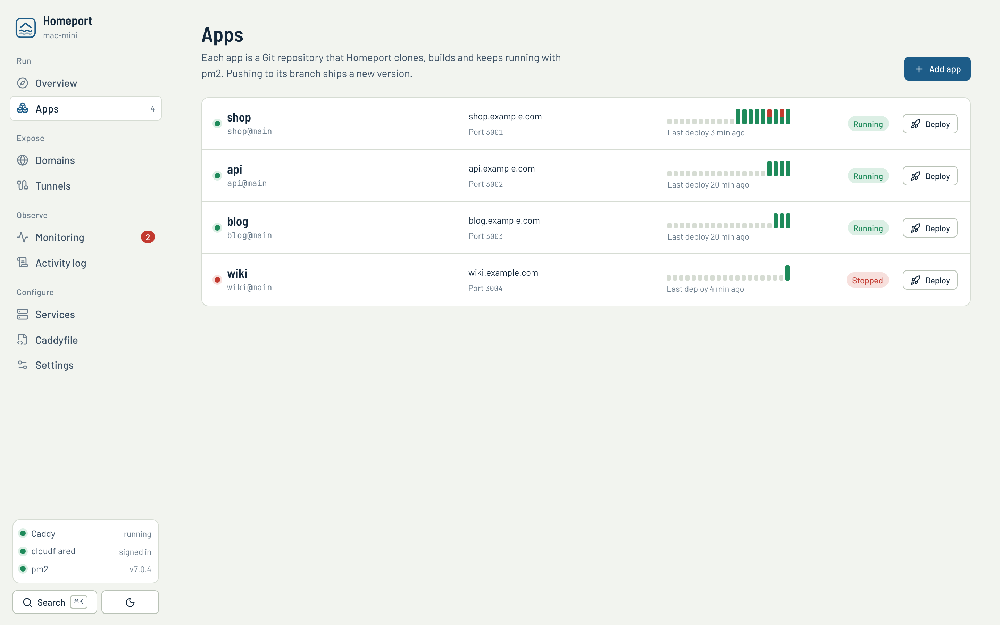 | 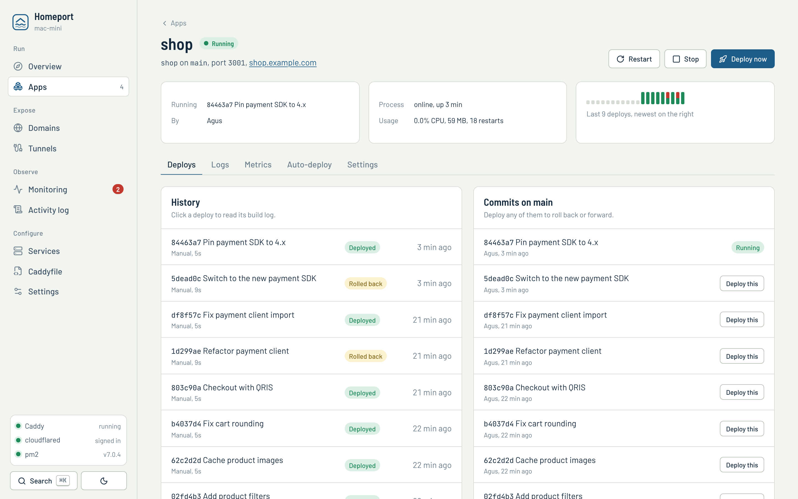 |
| **Apps.** The last 20 deploys of each app at a glance: succeeded, failed, or rolled back. | **App page.** Deploy history with build logs, and every commit on the branch. |
| 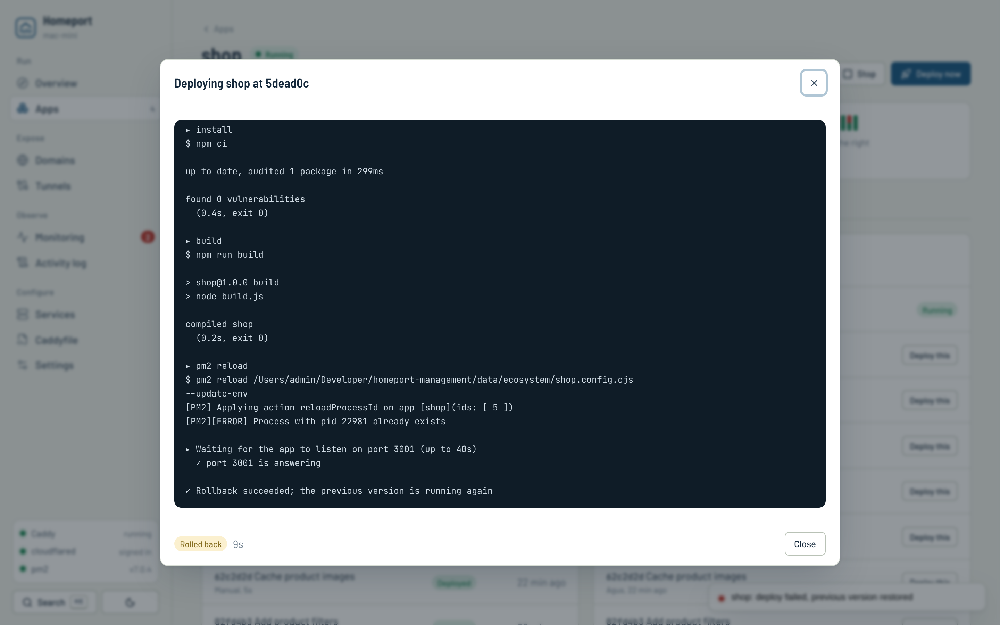 | 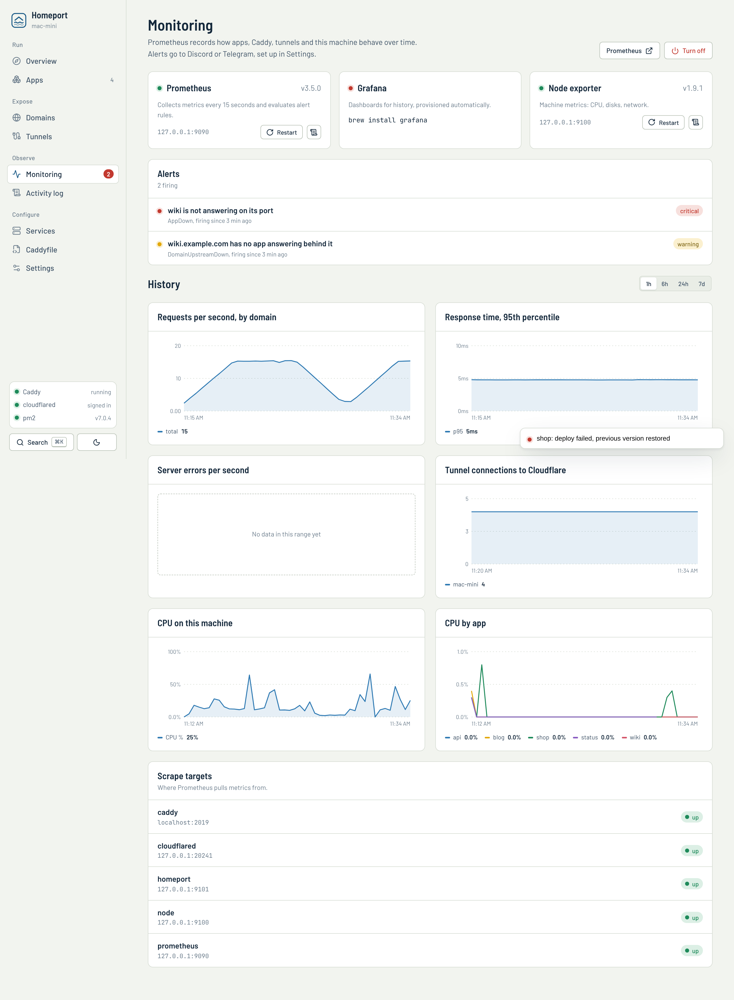 |
| **Deploy log.** A build that failed its health check and rolled back on its own. | **Monitoring.** Alerts, requests and latency per domain, CPU and memory per app. |
| 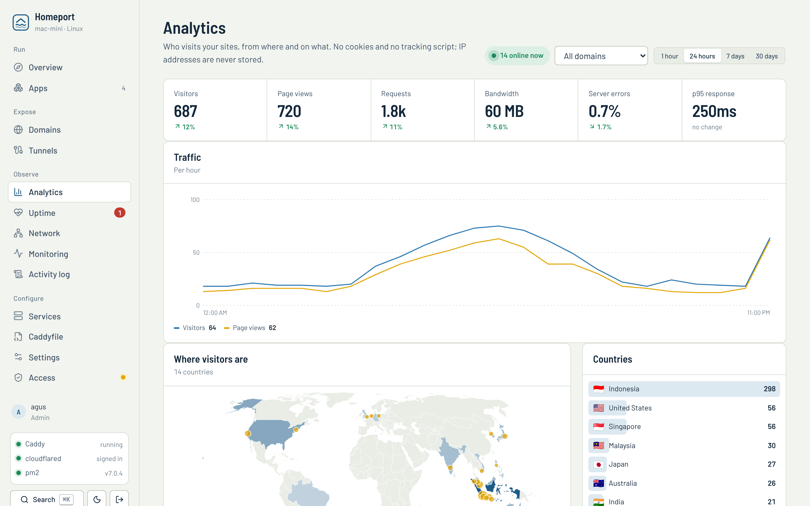 | 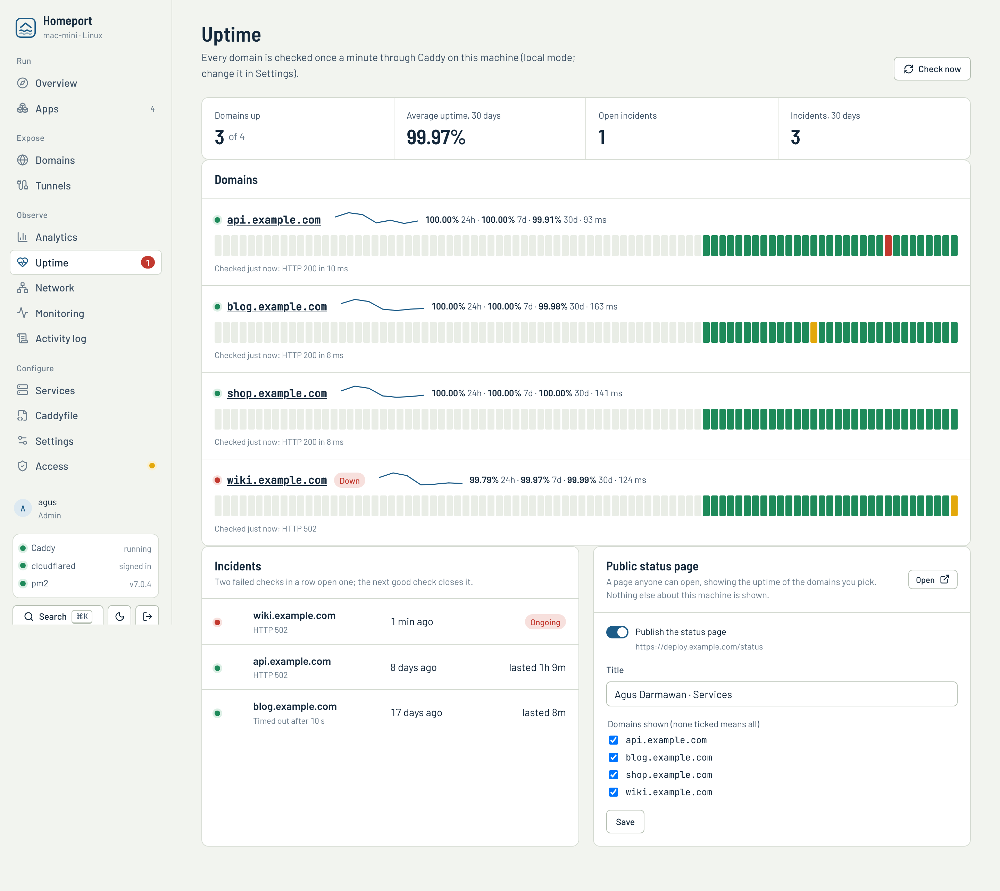 |
| **Analytics.** Visitors, countries, pages, sources and devices, compared with the previous period. | **Uptime.** A check every minute, incidents, and 90 days of history. |
| 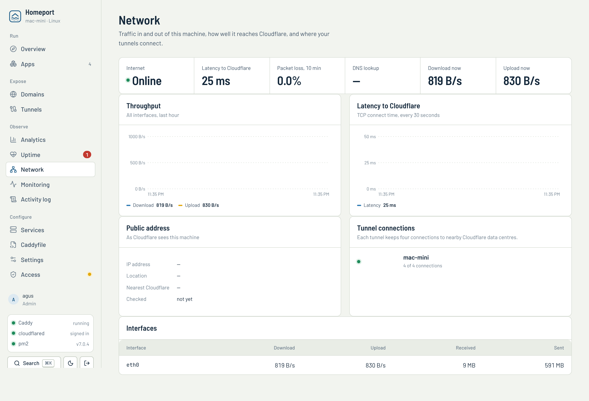 | 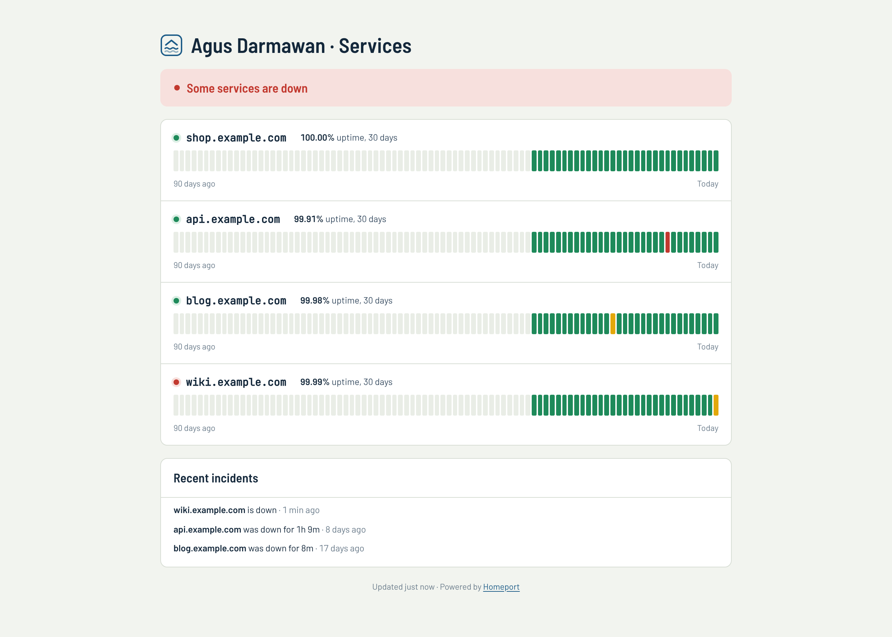 |
| **Network.** Throughput, latency and packet loss to Cloudflare, and where each tunnel connects. | **Status page.** Public, without sign-in, for the domains you choose. |
| 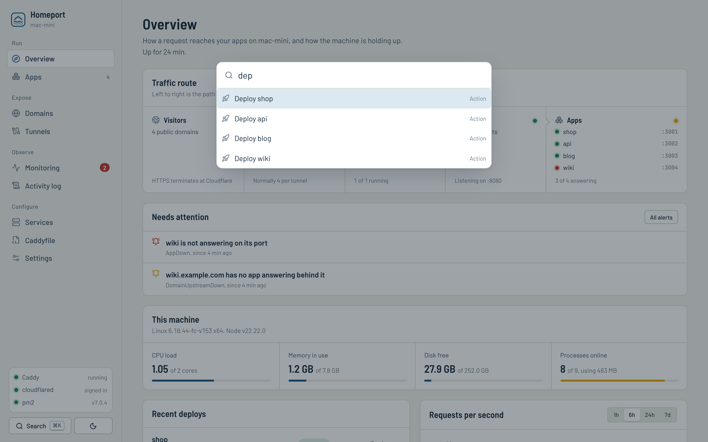 | 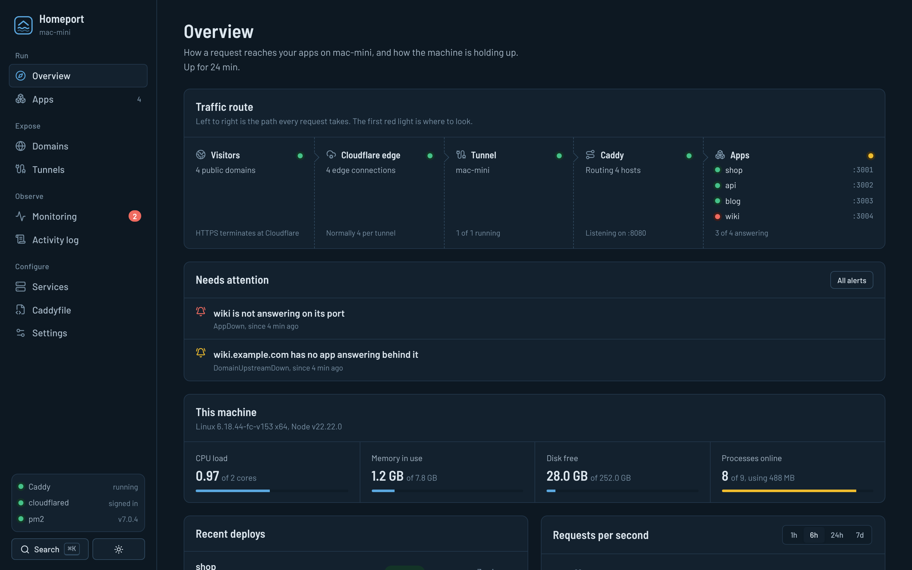 |
| **Command palette.** <kbd>⌘</kbd> <kbd>K</kbd> to jump to any page or app, or start a deploy. | **Dark theme.** Follows the system setting. |
| 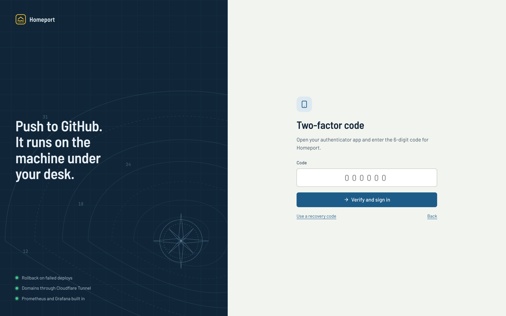 | 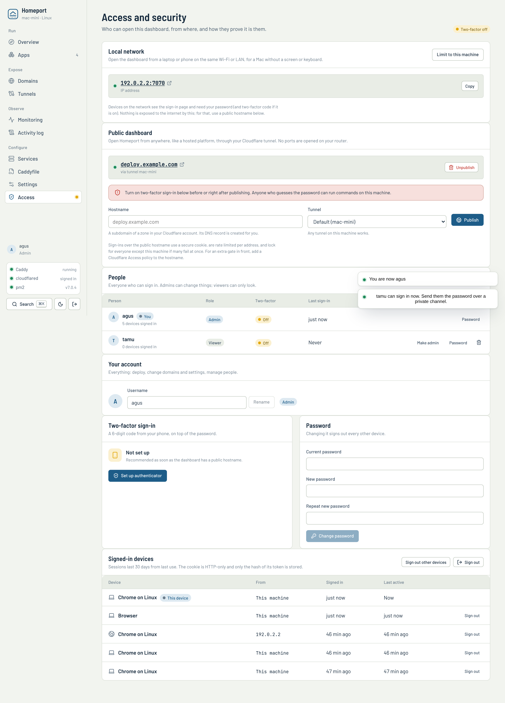 |
| **Sign-in.** Password and a code from your authenticator app. | **People.** Admins deploy; viewers look, with secrets masked. |

## How it works

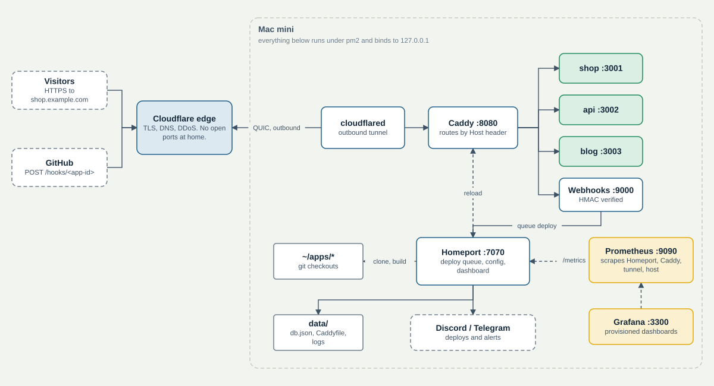

Visitors and GitHub webhooks reach Cloudflare. A `cloudflared` tunnel, dialled out from the machine, carries every hostname to a single Caddy, which routes by `Host` header to each app's local port. Homeport writes all of that configuration from what you enter in the dashboard and runs every piece under pm2. Nothing listens on a public interface.

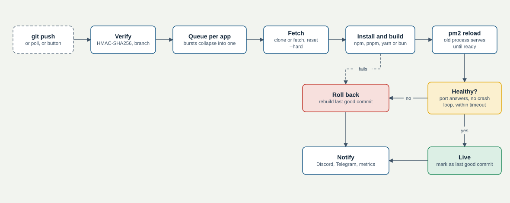

A deploy checks the webhook signature and branch, waits its turn in the app's queue, fetches the commit, installs and builds with the project's package manager, and reloads the app under pm2 while the old process keeps serving. Homeport then waits for the port to answer. If the build fails or the app keeps crashing, the last good commit is rebuilt. Either way, a notification goes out.

## Install

**Mac**

```bash
git clone https://github.com/DarmawanWeb/homeport-management.git
cd homeport-management
bash setup-mac.sh
```

The script installs Caddy, cloudflared, pm2, Prometheus and Grafana with Homebrew, builds Homeport, starts it, and prints the address to open from any laptop or phone on your network, such as `http://mac-mini.local:7070`. To update, `git pull` and run it again.

**Synology NAS or any Docker host**

```yaml
services:
  homeport:
    image: ghcr.io/darmawanweb/homeport:latest
    network_mode: host
    restart: unless-stopped
    volumes: [./data:/data, ./apps:/apps]
```

Open `http://<nas-ip>:7070` and enter the setup code from the container log.

**Linux or Raspberry Pi:** `bash setup-linux.sh`, with no root needed. See the [Synology and Linux guide](https://darmawanweb.github.io/homeport-management/guide/synology).

**Starting over.** `bash reset-mac.sh` removes an old hand-made Caddy or tunnel setup after backing it up. `--full` also removes Homeport, every app it deployed and their caches, and `--reinstall` does that and installs again. Add `--dry-run` to see the list first.

The [getting started guide](https://darmawanweb.github.io/homeport-management/guide/getting-started) covers the first run, remote access and keeping the machine awake.

## Under the hood

- **Config that cannot take the sites down.** The Caddyfile, tunnel ingress, pm2 ecosystem files, Prometheus rules and Grafana dashboards are pure functions of the stored state. Caddy validates every change before it is applied, and a rejected change is rolled back. ([decision 4](docs/decisions/0004-generated-config.md))
- **Real crashes, not deploys.** pm2's restart counter rises on every reload. Planned actions open a short window, so the crash metric and its alert only count restarts nobody asked for.
- **A pm2 quirk found in production.** pm2 7 injects `name=homeport` into the environment of the processes it runs and prefers it over `--name`, so every app Homeport started was registered as `homeport`. Child environments are now scrubbed, and a regression test keeps it that way.
- **Trust starts on the machine.** Only a request that is really local (loopback socket, loopback `Host`, no proxy headers) can create the first account or reset it, which also rules out DNS rebinding. Passwords use scrypt, two-factor is RFC 6238 TOTP with replay protection, and session tokens are stored only as hashes. ([decision 7](docs/decisions/0007-public-dashboard.md))
- **Monitoring tested in CI.** Every PromQL expression in the dashboards and alert rules runs against a real Prometheus, and the generated config goes through `promtool check config`. ([decision 6](docs/decisions/0006-as-code.md))
- **One code path, four platforms.** Homeport only drives CLIs, so macOS, Linux, Synology and Docker differ in defaults, not in code. CI boots the Docker image, sets it up from another machine, restarts it and checks that every process came back.
- **Analytics that forget.** Unique visitors are counted with a salt that is thrown away every day, and only hourly totals per domain are kept. ([decision 8](docs/decisions/0008-privacy-first-analytics.md))

## Tech stack

| Layer | Choice |
|---|---|
| Server | Node 20+, TypeScript (strict), Fastify 5, Zod 4, prom-client |
| Dashboard | React 19, TanStack Query, Vite, hand-written CSS with design tokens, SVG charts |
| Runtime | pm2, Caddy, cloudflared on macOS, Linux, Synology DSM and Docker (amd64, arm64) |
| Observability | Prometheus, Grafana, node_exporter, Discord and Telegram |
| Quality | Biome, Vitest, `tsc` on both projects. CI also checks PromQL, builds and boots the image, and runs the Linux installer on x86 and ARM |
| Docs | VitePress, architecture decision records, diagrams generated as code |

## Development

```bash
npm ci
npm run dev          # API on :7070, restarts on change
npm run dev:web      # dashboard on :5173
npm run check        # Biome
npm run typecheck
npm test
npm run docs:dev
```

```
src/server/   Fastify app: deploys, Caddy, cloudflared, pm2, webhooks, notifications, monitoring
src/shared/   types shared by the server and the dashboard
web/src/      React dashboard
scripts/      diagram generator and monitoring checks
docs/         documentation site, guides, reference, decision records
```

Conventions and the CI pipeline are described in [development](https://darmawanweb.github.io/homeport-management/reference/development).

## Scope

Homeport runs trusted Node services for one person or a small team on one machine. It is not a multi-tenant host, and apps are not isolated from each other. The [design decisions](https://darmawanweb.github.io/homeport-management/decisions/) explain why it uses pm2 instead of containers and what that trade-off costs.

## License

[MIT](LICENSE)
